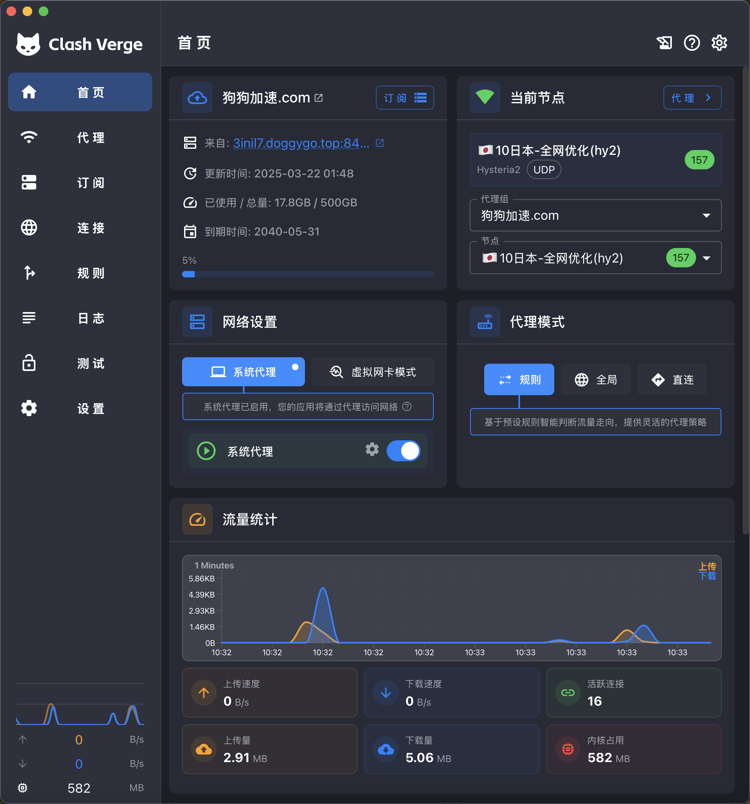
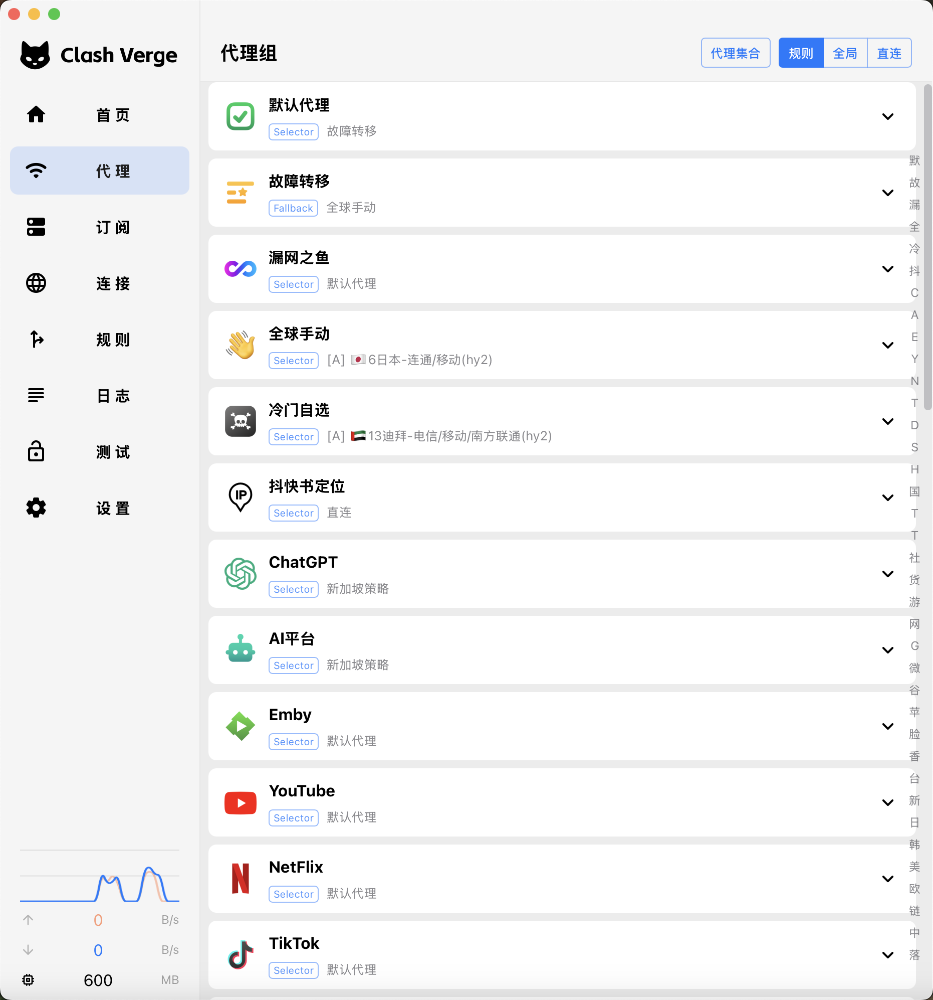

<h1 align="center">
  
  <br>
  Continuation of <a href="https://github.com/zzzgydi/clash-verge">Clash Verge</a>
  <br>
</h1>

<h3 align="center">
A Clash Meta GUI based on <a href="https://github.com/tauri-apps/tauri">Tauri</a>.
</h3>

<p align="center">
  Languages:
  <a href="./README.md">简体中文</a> ·
  <a href="./docs/README_en.md">English</a> ·
  <a href="./docs/README_es.md">Español</a> ·
  <a href="./docs/README_ru.md">Русский</a> ·
  <a href="./docs/README_ja.md">日本語</a> ·
  <a href="./docs/README_ko.md">한국어</a> ·
  <a href="./docs/README_fa.md">فارسی</a>
</p>

## Preview

| Dark                             | Light                             |
| -------------------------------- | --------------------------------- |
|  |  |

## Install

请到本仓库的发布页面下载安装包：[Release page](https://github.com/linua9527-code/linua_clash-verge/releases)<br>
Download installers from this repository's [Release page](https://github.com/linua9527-code/linua_clash-verge/releases)<br>
This release workflow builds Windows (x64/ARM64), Linux (x64), and macOS 11+ (Intel/Apple Silicon).

#### 我应当怎样选择发行版

| 版本        | 特征                                     | 链接                                                                                   |
| :---------- | :--------------------------------------- | :------------------------------------------------------------------------------------- |
| Stable      | 正式版，高可靠性，适合日常使用。         | [Release](https://github.com/linua9527-code/linua_clash-verge/releases)                 |
| AutoBuild   | 手动触发的测试构建，可能存在缺陷。       | [AutoBuild](https://github.com/linua9527-code/linua_clash-verge/releases/tag/autobuild) |

#### 安装说明和常见问题可参考[上游文档](https://clash-verge-rev.github.io/)

### 使用 GitHub Actions 构建

推送与 `package.json`、`src-tauri/Cargo.toml` 和 `src-tauri/tauri.conf.json` 版本一致的标签（例如当前版本 `v2.5.5`），`Release Build` 将构建 Windows x64/ARM64、macOS Intel/Apple Silicon 和 Linux x64 的安装包，并在全部构建成功后发布到本仓库的 Releases。也可以在 Actions 页面手动运行 `Development Test` 下载构建产物；`Auto Build` 仅手动运行。

```bash
git tag v2.5.5
git push origin v2.5.5
```

工作流自带 `GITHUB_TOKEN`，普通安装包不需要额外 Secret。macOS 系统签名与公证需要另行配置 `APPLE_CERTIFICATE`、`APPLE_CERTIFICATE_PASSWORD`、`APPLE_SIGNING_IDENTITY`、`APPLE_ID`、`APPLE_PASSWORD` 和 `APPLE_TEAM_ID`；未配置时产物仍可构建，但 macOS 可能提示未验证开发者。Windows 安装包同样未配置代码签名证书。

Telegram 通知默认关闭。若要启用，设置仓库变量 `ENABLE_TELEGRAM=true`，并配置 Secrets `TELEGRAM_BOT_TOKEN`、`TELEGRAM_CHAT_ID_RELEASE` 和 `TELEGRAM_CHAT_ID_TEST`；通知只会发送到这些频道。

---

## Features

- 基于性能强劲的 Rust 和 Tauri 2 框架
- 内置[Clash.Meta(mihomo)](https://github.com/MetaCubeX/mihomo)内核，并支持切换 `Alpha` 版本内核。
- 简洁美观的用户界面，支持自定义主题颜色、代理组/托盘图标以及 `CSS Injection`。
- 配置文件管理和增强（Merge 和 Script），配置文件语法提示。
- 系统代理和守卫、`TUN(虚拟网卡)` 模式。
- 可视化节点和规则编辑
- WebDav 配置备份和同步

### FAQ

Refer to the [upstream FAQ](https://clash-verge-rev.github.io/faq/windows.html)

## Development

See [CONTRIBUTING.md](./CONTRIBUTING.md) for more details.

To run the development server, execute the following commands after all prerequisites for **Tauri** are installed:

```shell
pnpm i
pnpm run prebuild
pnpm dev
```

`pnpm dev` preserves the Development Channel's installed service state: an
existing service is used, while a previously uninstalled service remains
uninstalled and the app starts in Sidecar mode. Use `pnpm dev:service` to
explicitly install or update the isolated development service before launch,
or `pnpm dev:sidecar` to force the unprivileged Sidecar workflow.

## Contributions

Issue and PR welcome!

## Acknowledgement

Clash Verge rev was based on or inspired by these projects and so on:

- [zzzgydi/clash-verge](https://github.com/zzzgydi/clash-verge): A Clash GUI based on tauri. Supports Windows, macOS and Linux.
- [tauri-apps/tauri](https://github.com/tauri-apps/tauri): Build smaller, faster, and more secure desktop applications with a web frontend.
- [Dreamacro/clash](https://github.com/Dreamacro/clash): A rule-based tunnel in Go.
- [MetaCubeX/mihomo](https://github.com/MetaCubeX/mihomo): A rule-based tunnel in Go.
- [Fndroid/clash_for_windows_pkg](https://github.com/Fndroid/clash_for_windows_pkg): A Windows/macOS GUI based on Clash.
- [vitejs/vite](https://github.com/vitejs/vite): Next generation frontend tooling. It's fast!

## Privacy

Clash Verge Rev 不收集任何用户数据，配置与日志仅保存在本地。详见[隐私政策](./PRIVACY.md)。

Clash Verge Rev does not collect any user data; configuration and logs stay on
your own device. See the [Privacy Policy](./PRIVACY.md) for details.

## License

GPL-3.0 License. See [License here](./LICENSE) for details.
